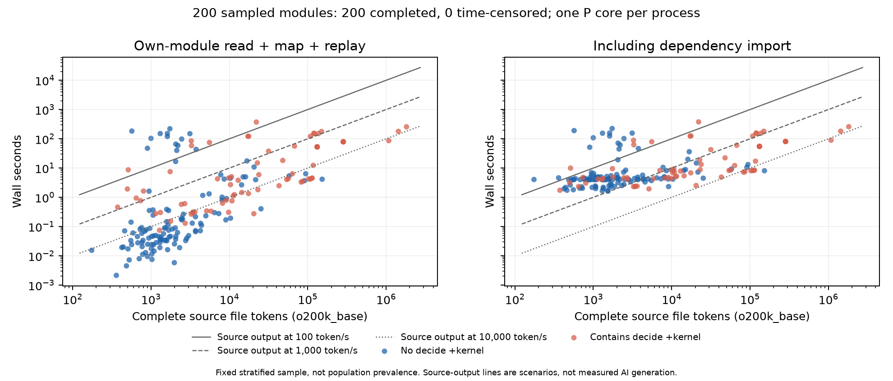

# Source generation scenarios versus original-kernel checking

This is a fixed stratified sample on OpenAI/math 4eaee875, using a full-file o200k_base token census and original Lean 4.34.1 kernel replay windows. The 100 / 1,000 / 10,000 token/s curves are **hypothetical source-output scenarios**, not measurements of a model, reasoning trace, prompt processing, retries or AI authorship.

## Results

The corrected pass completed all 200 requested modules with exit 0. There were no timeouts, kernel rejections, OOM events, resource stops or tool failures. Its acquisition took 719.503 seconds with at most eight independent one-core jobs; this is not the sum of per-module costs.

The following proportions compare measured wall time with complete-file source tokens divided by each hypothetical output rate:

| Source-output scenario | Check only: read + map + replay | Import + check |
| --- | ---: | ---: |
| 100 token/s | 18/200 (9.0%) | 20/200 (10.0%) |
| 1,000 token/s | 35/200 (17.5%) | 128/200 (64.0%) |
| 10,000 token/s | 88/200 (44.0%) | 192/200 (96.0%) |

This composite is deliberately tail-biased. In the uniform group of 100 completed-build modules, the corresponding check-only wall fractions are 0/100 (0.0%), 3/100 (3.0%), 17/100 (17.0%); including import they are 2/100 (2.0%), 85/100 (85.0%), 100/100 (100.0%). Rates are listed as 100, 1,000 and 10,000 token/s.

CPU comparisons remain separate from latency:

| Source-output scenario | Check CPU exceeds source-output seconds | Import + check CPU exceeds source-output seconds |
| --- | ---: | ---: |
| 100 token/s | 18/200 (9.0%) | 20/200 (10.0%) |
| 1,000 token/s | 35/200 (17.5%) | 125/200 (62.5%) |
| 10,000 token/s | 84/200 (42.0%) | 191/200 (95.5%) |

The 200 files contain 9,391,329 tokens. Their own-module component totals 4607.621256 CPU seconds, yielding **2,038.216 source tokens per checking CPU second** as a weighted ratio. Adding 677.531599 import CPU seconds gives 1,776.927 tokens per import-plus-check CPU second. Pure replay alone totals 4607.350779 CPU seconds and yields 2,038.336 tokens per CPU second.

For pure replay alone in this same corrected pass, the wall-time crossing counts at the three rates are 18/200 (9.0%), 35/200 (17.5%), 84/200 (42.0%). These are secondary columns, rather than a substitute for the requested component boundary.

One concrete sampled outlier is OAI.NumberTheory.PadicHodge.IntegralComparison.Balanced.SheafifiedSectionsIdentity: its complete original source is 569 tokens, its own-module component took 183.809333 wall seconds (183.260333 CPU seconds), and dependency import took 6.896128 wall seconds. At the hypothetical 100 token/s rate, writing that complete file would take 5.69 seconds. The runtime contrast is measured; actual model generation and the cause of this outlier are not measured here.

The data support the existence of short-source, expensive-check outliers. They do not establish actual generation rates or library-wide prevalence. The 100 / 1,000 / 10,000 token/s lines are scenarios; actual AI generation would additionally involve model choice, prompts, reasoning, retries and edits.

## Source and sampling

The token census covers all 163,096 source files, excluding the lakefile configuration unit, from the retained original GitHub commit archive. The extracted Workspace has compatibility changes and no original Git object database; its working-tree bytes were not substituted for the pinned archive. tiktoken 0.14.0 o200k_base encode_ordinary counts the complete UTF-8 file, including comments and whitespace, without chat framing.

There are 1,785,482,487 source bytes and 676,598,073 tokens. The median per-file bytes/token ratio is 2.922039581; the aggregate ratio is 2.638911576. These are real tokenizer counts, rather than a four-bytes-per-token approximation.

Random seed: 20261107. The eligible timing frame is W's 162,170 completed source modules in cc5bcc18. The 926 deferred modules have source-token rows but are not eligible for this runtime sample. Using Python random.Random, draw sequentially:

1. 100 from the completed frame sorted by module name.
2. 50 from the top ceil(1% × 162,170) = 1,622 modules by compilation CPU, with module-name tie breaking; sample that pool sorted by module name.
3. 50 from the 5,848 completed modules tagged by the retained lexical decide +kernel counter.

The three draws have no overlap in this seed: 200 unique modules. selection.csv is the frozen draw list. The top-percentile inclusion threshold is 98.882779 compilation CPU seconds. Compilation CPU is a sampling feature from the completed census, not a substitute for checking cost. The original compilation resource/parallelism conditions differ from this one-core checker experiment. All 200 original archive source digests match the existing census compile-record source digests in a retrospective provenance comparison; this did not alter sample admission or runtime decisions.

The combined sample oversamples expensive compilation and decision sites. **Combined fractions are sample descriptions, not library prevalence.** The uniform group describes the completed-build frame, which itself excludes the 926 deferred modules. Presence of decide +kernel is a lexical source tag, not a guarantee that a particular replay is expensive.

## Measurement boundary

No project, target or dependency was recompiled, and the frozen checker, paper and blog were not changed. The measurement entry executes as official Lean --run without -o/-c or lake build; the small entry itself is elaborated by that command. Its startup/elaboration is outside the phase windows.

Window.lean uses the same public Kernel.Environment.replay API as the official default checker and the earlier TimedReplay stock path. It reads the selected W artifact directly, imports only its declared dependencies through importModulesCore and finalizeImport, and then replays that target's constant map. The existing clock.so from the declaration-distribution measurement supplies only CLOCK_PROCESS_CPUTIME_ID; it does not alter the kernel. The original C clock source is research/chunked-kernel-check/cpu_clock.c.

- Import wall/CPU: importModulesCore plus finalizeImport for the target's declared imports.
- Check wall/CPU: the sum of this target's own artifact-read, constant-map construction and replay phases, excluding dependency import. These are separately recorded, non-overlapping intervals. Pure replay wall/CPU is also recorded. Its interval includes one flushed phase marker, whose fixed observation cost is retained rather than estimated away.
- Whole-process wall/CPU: separately recorded, includes script elaboration, target reading/map creation, phase output, cleanup and startup.
- Import-plus-check: sum of the two phase windows; it does not pretend to include all whole-process overhead.

Upstream replay skips unsafe/partial declarations and may skip same-interface imported theorems; this measures the official replay obligation, not strict rechecking of every stored proof body. Imported dependencies are trusted in each target window. The original four Figure 1(b) points used an own-module read/map/replay component after a shared checked dependency frontier. The main new check metric includes the same three components, with dependency import excluded; these targets use a freshly finalized declared-import context rather than a previously checked shared frontier. The old four points are not pooled into the sample.

Processes run on P cores 0–7, one core per process, LEAN_NUM_THREADS=1 and -j1, with at most eight active verification jobs. The cheapest selected module qualified the entry first and is retained as one sample; remaining jobs were scheduled by descending compilation CPU subject to measured-resource admission estimates. Measurement order was not randomized. The page cache was not flushed; cache state is uncontrolled. There is no Lean -M and no P-core lock for this explicitly authorized experiment; other Workspaces were left unchanged. External cgroups bound the combined owned workload and each child. The node retains an 8 GiB available-memory stop; only owned jobs may be killed. The initial actual memory ceiling and live CPU binding evidence remain in the raw capture.

Each module has a 900-second whole-process limit, including import/setup. Timeouts are retained and distinguish whether checking started. They are **right-censored observations, not proof rejections or completed 900-second checks**. Resource failures, tool/import failures and kernel diagnostic events remain separate.

## Interpreting incomplete costs

Every requested module remains in sample.csv. Exact successful phase times are used where available. For an interrupted checking window, reduction uses a later live, unfinished-check CPU snapshot taken before its timeout, less the sampler's CPU baseline after observing the check-begin marker. This excludes termination/cleanup CPU. If that observation is unavailable, no positive lower bound is invented. This is a conservative lower bound on that window's CPU. Because the process is pinned to one hardware core, that CPU lower bound also bounds wall time from below. Import-plus-check adds the separately completed import window if available.

For each rate, summary.json gives definitely-exceeds, definitely-not-exceeds and unresolved counts, and a lower/upper fraction over **all requested modules**. It also gives the conditional completed-only fraction. A censored point below a rate line remains unresolved; it is not silently counted as cheap.

Completed-only token/check-CPU throughput is a weighted ratio of summed source tokens to summed check CPU. If any target has unresolved completion cost, there is no exact all-sample throughput: the summary gives the observed work lower bound and corresponding throughput upper bound instead. No unbounded-time completion cost or library-wide checking cost is extrapolated.

## Files

- tokens.csv.gz: all 163,096 pinned source modules, source paths, bytes and tokens.
- selection.csv: fixed stratum membership and original compilation CPU.
- sample.csv: one row per requested runtime sample, including every non-success.
- summary.json: token totals, strata, rate-crossing bounds, throughput and terminal counts.
- generation-vs-checking.png / .svg / .pdf: source tokens versus check wall time and import-plus-check wall time, with scenario lines. Up arrows show conservative lower bounds.
- count_tokens.py, Window.lean, measure.py, analyze.py and plot.py: acquisition/reduction code.

The full source file is the token unit, not the proof term or a model's incremental patch. The experiment therefore tests the specified full-file output scenarios; it does not show that an actual deployed model produced these files at those rates. It cannot turn compilation CPU into kernel-checking CPU.

All raw stdout/stderr, commands, sample plan, resource records and failed preparation remain under the path recorded in summary.json. Preparation failures (a module-name collision with Python's stdlib tokenize, an unavailable Git object database, cgroup subtree setup, SDK PATH discovery, and the pre-existing clock export name) are preserved. They occurred before a qualified target-check window and are not substituted for data or dropped successful/timeout samples. The token census was completed from the original commit archive; no approximation tokenizer was needed.

This is self-review (自审); no independent runtime review or upstream action is claimed.

## Re-running data reduction and the figure

With tiktoken 0.14.0 installed, the tokenizer accepts the retained commit archive as an explicit input:

    python3 data/generation-vs-checking/count_tokens.py NEW_PVC_CAPTURE CHECKOUT ORIGINAL_4EAEE875_ARCHIVE.tar.gz

The capture directory must exist; output tokens.csv.gz is written in CHECKOUT/data/generation-vs-checking. The script reads the public census module mapping in that checkout.

For a retained native capture root (including measurement-current.txt and the frozen sample plan), rerun:

    python3 data/generation-vs-checking/analyze.py CAPTURE_ROOT CHECKOUT
    python3 data/generation-vs-checking/plot.py data/generation-vs-checking

The figure alone regenerates from the committed sample.csv and summary.json with Matplotlib; it does not require native artifacts. The observed plot environment used Matplotlib 3.11.2.

The actual native acquisition was:

    taskset -c 8-9 python3 NATIVE_CAPTURE/measure.py NATIVE_CAPTURE CHECKOUT

This research adapter requires the retained sample-plan.json, Window.lean, Lean SDK, existing clock.so and the bound dependency search path named in provenance.json and raw command records. Those files are not included as an installable tool or a new checker. On another machine, their input paths and campaign deadline must be supplied for that machine; no timing from a changed environment is silently merged into this sample.

Validation recomputed the full token totals, the 200-module sample identity, the crossing counts, phase/process timing containment and original-source pairing from the recorded data. Every target returned exactly one complete event with exit 0; no OOM event was recorded, and all per-module and aggregate owned cgroups were retired. The PNG was visually inspected after correcting legend spacing. These validations do not add an independent runtime review or a population claim.

## Protocol correction retained in raw data

The first qualified 200-module pass measured pure replay only. Final scope review found that Figure 1(b)'s component also contains target artifact reading and map construction. That initial pass remains intact in native-4 and replay-only-reduction under the capture root. The same fixed 200 targets were then rerun with explicit read/map timers; final sample.csv, summary.json and the figure use that corrected component. Pure replay columns remain available from the corrected run. No first/second-pass timings are pooled, no target is replaced, and no target or dependency is rebuilt.
